# Technical Implementation Plan: Functional CD Player Integration (`mycds`)

## 1. Executive Summary & Milestone Scope

This document defines the technical implementation plan for integrating the real CD-DA playback, audio output, disc source, and CDDB metadata subsystems from `mycds_core` (`build/cdplayer`) into the Dear ImGui / SDL3 / OpenGL graphical user interface (`build/mycds`), turning `mycds` from a simulation prototype into a fully functional hardware-styled CD player.

### Milestone 1 Scope
- **Real Audio Playback in GUI:** Replace the synthetic time ticker and synthetic beat-generator VU meter in `CdDisplayModel` with real sector streaming and SDL3 audio output via `PlaybackController` and `AudioOutput`.
- **Unified Source Loading (Physical CD & Disc Images):** Opening a physical optical drive (`/dev/sr0`, etc.) or a disc image (`.cue`, `.toc`) from either the Eject Menu (`CD` and `Image/File` screens) or command-line arguments (`mycds [path_or_device]`, `--device`, `--image`) hands a live `std::unique_ptr<DiscSource>` to `PlaybackController`.
- **Real-Time Volume, Stereo Balance, & PCM Level Metering:** Implement lock-free stereo gain/balance scaling and real-time PCM level metering inside `AudioOutput::Impl::audioStreamCallback` so the GUI's rotary **Volume** and **Balance** knobs control actual audio output and the 24-segment dual-channel LED **Volume Meter** reflects the true played audio signal.
- **Full Transport & Playback Mode Integration:** Wire **Play/Pause**, **Stop**, **Prev/Next Track**, **Fast-Forward / Rewind Seeking**, **Direct Track Jump**, **Repeat (`Off` / `Disc` / `Track`)**, and **Shuffle** to `PlaybackController` while preserving gapless Red Book playback across contiguous tracks.
- **Record Button Disabled:** For this first milestone, the hardware **Record** button (`##BtnRecord`) and the `D` keyboard shortcut are disabled (non-interactive, visually dimmed, tooltip indicating *"Record CD to Library (Coming in a future milestone)"*).
- **Non-Blocking Metadata (Sidecar & Async CDDB Lookup):** Automatically load local `.mycds.json` sidecar or CUE/CD-TEXT metadata on disc open, and perform asynchronous GnuDB/CDDB lookup on a background worker thread so the UI and audio threads never block on network I/O.

### Explicit Non-Goals for This Milestone
- Ripping physical CDs into `.bin`/`.toc` or `.cue` images (the **Record** button will do nothing and remain disabled).
- Persisting ripped images into a local/remote library database (the **Library** screen in the Eject Menu retains its existing catalog structure, though if a library entry has an associated image path it can optionally open it, or remain a preview boundary until the ripping/library milestone).

---

## 2. Current State & Gap Analysis

### 2.1 Core Engine (`mycds_core` / `build/cdplayer`)
| Component | Files | Current Capabilities | Gaps for Full GUI Integration |
|---|---|---|---|
| **Disc Sources** | `src/source/disc_source.hpp`, `physical_cd_source.cpp`, `image_source.cpp`, `toc_image_source.cpp`, `cue_image_source.cpp` | Normalized LBA addressing (`Track 1 INDEX 01 = LBA 0`), S16LE 44.1 kHz stereo PCM sector reading, CD drive enumeration (`enumerate_cd_drives()`), tray eject (`eject_cd_drive()`). | None — ready for direct ownership by `PlaybackController`. |
| **Audio Output** | `src/audio/audio_output.hpp`, `audio_output.cpp`, `pcm_ring_buffer.hpp` | Lock-free `PcmRingBuffer` (SPSC) feeding SDL3 `SDL_AudioStream` callback (`S16LE`, 2ch, 44,100 Hz). | 1. No software **Volume** or **Stereo Balance** scaling.<br>2. No real-time L/R **PCM level / peak** extraction for the LED VU meter. |
| **Playback Controller** | `src/playback/playback_controller.hpp`, `playback_controller.cpp` | Background producer thread reading multi-sector chunks, gapless streaming across contiguous `TrackType::Audio` tracks, `play()`, `pause()`, `stop()`, `seekToTrack()`, `seekToLba()`, `status()`. | 1. Streams from `anchorLba` to `playableEndLba` (end of disc). Needs awareness of single-track boundary action when `RepeatMode::Track` or `Shuffle` is active, or `CdDisplayModel::update()` must orchestrate track-end transitions.<br>2. Needs pass-through setters/getters for volume, balance, and real-time audio levels from `AudioOutput`. |
| **Metadata & CDDB** | `src/metadata/cddb_disc_id.cpp`, `cddb_provider.cpp`, `metadata_matcher.cpp`, `metadata_store.cpp` | CDDB Disc ID calculation, synchronous libcurl HTTP query/fetch to GnuDB, layout validation, `.mycds.json` sidecar persistence. | Synchronous HTTP calls block for up to 5–10s on network timeouts; GUI needs an asynchronous background lookup worker and status state (`Idle`, `LookingUp`, `Resolved`, `NoMatch`, `Error`). |

### 2.2 Graphical Interface (`src/gui/` / `build/mycds`)
| Component | Files | Current Behavior (Mock / Prototype) | Required Changes |
|---|---|---|---|
| **Display Model** | `src/gui/cd_display_model.h`, `cd_display_model.cpp` | Initializes with hardcoded 12-track Pink Floyd mock tracklist. `update(dt)` increments `track_elapsed_seconds_ += dt`, synthesizes fake 124 BPM sine-wave VU meter pulses, and emulates high-speed 350x recording. | Embed or bind to `mycds::PlaybackController`. Drive state (`is_playing()`, `current_track_number()`, `track_elapsed_seconds()`, `volume_levels()`) from `PlaybackController` when a source is loaded. Handle "No Disc Loaded" state cleanly on startup when no disc/image is present. |
| **Eject Menu** | `src/gui/cd_eject_menu_widget.cpp`, `eject_menu_state.cpp` | `LoadDiscSourceIntoModel()` opens `PhysicalCdSource` or `ImageSource` as a temporary local variable, copies track durations/titles into `CdDisplayModel`, and **immediately destroys the `DiscSource`**. | Pass ownership of `std::unique_ptr<DiscSource>` into `model.open_disc_source(std::move(source))` so `PlaybackController` keeps the source open and streams audio sectors from it. |
| **Controls Widget** | `src/gui/cd_controls_widget.cpp` | Renders transport buttons, knobs, and an active **Record** button (`##BtnRecord`) that triggers `model.start_recording()`. | Disable `##BtnRecord` for Milestone 1 (ignore clicks, render dimmed/disabled state, update tooltip). Disable transport controls when no disc is loaded (except **Eject**, **Shuffle**, **Repeat**, **Volume**, **Balance**). |
| **Main Loop & CLI** | `src/gui/main.cpp` | Initializes `SDL_INIT_VIDEO \| SDL_INIT_EVENTS`. Accepts only `--stopped` / `--paused`. Binds `D` key to `start_recording()`. | 1. Parse positional argument `mycds <device_or_image>` plus `--device <dev>`, `--image <path>`, `--stopped`, `--paused`.<br>2. Remove `D` key shortcut for recording.<br>3. Auto-open CLI-specified source or last-used source on startup. |

---

## 3. Target Architecture

```mermaid
flowchart TD
    subgraph GUI["GUI Thread (SDL3 Video/OpenGL + Dear ImGui)"]
        Main["src/gui/main.cpp<br/>Event Loop & Keyboard Shortcuts"]
        Widgets["GUI Widgets<br/>Display / VolumeMeter / Controls / Playlist / Cover / EjectMenu"]
        Model["CdDisplayModel<br/>UI Facade, Repeat/Shuffle Policy, Ballistics, Async CDDB Coordinator"]
    end

    subgraph Core["mycds_core (Playback & Metadata)"]
        PC["PlaybackController<br/>State Machine & Position Resolver"]
        Worker["Producer Thread<br/>Reads 16-sector chunks"]
        DS["DiscSource<br/>PhysicalCdSource | TocImageSource | CueImageSource"]
        AO["AudioOutput<br/>Volume/Balance Scaling & RMS/Peak Metering"]
        RB["PcmRingBuffer<br/>Lock-Free SPSC Queue"]
        CDDB["Async Metadata Worker<br/>MetadataStore Sidecar + CddbCompatibleProvider"]
    end

    subgraph SDL["SDL3 Audio Thread"]
        CB["AudioOutput::audioStreamCallback<br/>Real-Time S16LE Consumer"]
    end

    Main --> Widgets
    Widgets --> Model
    Main --> Model
    Model --> PC
    Model --> CDDB
    PC --> Worker
    Worker --> DS
    Worker --> RB
    PC --> AO
    CB --> RB
    CB --> AO
```



### Key Architectural Invariants Preserved
1. **No Backend Leakage into GUI Headers:** `cd_display_model.h` and widget headers remain free of `libcdio`, `libMirage`, `libcurl`, and `SDL_AudioStream` types.
2. **Real-Time Audio Safety:** The SDL3 audio callback performs only lock-free `PcmRingBuffer` reads, in-place integer/float sample scaling for Volume/Balance, and lock-free atomic stores of stereo peak/RMS amplitudes. It never allocates memory, acquires mutexes, or touches `DiscSource`.
3. **Headless Unit Testability:** `CdDisplayModel` continues to support headless unit testing in `cd_display_model_tests` and `cd_controls_widget_tests` (using either an injected dummy-driver `PlaybackController` or a pure in-memory/no-disc state).

---

## 4. Detailed Component Design

### 4.1 Real-Time Volume, Balance, and Level Metering in `AudioOutput`

**Files:** [src/audio/audio_output.hpp](file:///home/kgorelov/git/mycds/src/audio/audio_output.hpp), [src/audio/audio_output.cpp](file:///home/kgorelov/git/mycds/src/audio/audio_output.cpp)

Currently, `AudioOutput::Impl::audioStreamCallback` copies raw `S16LE` bytes from `PcmRingBuffer` directly into `SDL_PutAudioStreamData`. To make the GUI's **Volume** knob, **Balance** knob, and **24-LED Volume Meter** work with real audio:

1. **Atomic Gain & Balance Parameters in `AudioOutput::Impl`:**
   - Add `std::atomic<float> volume{0.8f}` (range `[0.0f, 1.0f]`) and `std::atomic<float> balance{0.0f}` (range `[-1.0f, 1.0f]`).
   - Add public methods on `AudioOutput`:
     ```cpp
     void setVolume(double volume) noexcept;   // Clamped to [0.0, 1.0]
     double volume() const noexcept;
     void setBalance(double balance) noexcept; // Clamped to [-1.0, 1.0]
     double balance() const noexcept;
     ```
   - Compute per-channel multipliers matching the existing stereo balance law in `CdDisplayModel`:
     $$\text{gain}_L = \text{volume} \times (\text{balance} > 0 ? (1.0 - \text{balance}) : 1.0)$$
     $$\text{gain}_R = \text{volume} \times (\text{balance} < 0 ? (1.0 + \text{balance}) : 1.0)$$

2. **In-Callback Sample Scaling & Level Measurement:**
   - Inside `AudioOutput::Impl::audioStreamCallback`, after reading `got` bytes (`got / 4` stereo frames of `int16_t` little-endian samples) from `ringBuffer`:
     - Iterate over the stereo frames `(int16_t left, int16_t right)`:
       - Scale `left = clamp(lrint(left * gain_L), -32768, 32767)` and `right = clamp(lrint(right * gain_R), -32768, 32767)`.
       - Accumulate `sum_sq_L`, `sum_sq_R` and track `max_abs_L`, `max_abs_R` across the callback chunk.
     - Compute normalized chunk levels in `[0.0, 1.0]` (e.g., combining RMS and peak or perceptual dB mapping calibrated to the `-30 dB .. +6 dB` scale on `cd_volume_meter_widget.cpp`, where `0 dB` is segment 18 of 24).
     - Store `instantLeftLevel` and `instantRightLevel` into `std::atomic<float>` members on `AudioOutput::Impl` with `std::memory_order_relaxed`.
   - When `paused` is true, or during an underrun/silence fill, store `0.0f` into `instantLeftLevel` and `instantRightLevel`.

3. **Level Query API:**
   - Add a lightweight struct and getter on `AudioOutput` (and forwarded by `PlaybackController`):
     ```cpp
     struct AudioMeterLevels {
         double left{0.0};
         double right{0.0};
     };
     AudioMeterLevels meterLevels() const noexcept;
     ```
   - `CdDisplayModel::update(double dt)` reads `controller_.meterLevels()` each frame and applies the existing fast-attack (`32.0/s`), smooth-decay (`7.5/s`), and peak-hold (`0.8s`) ballistics in `CdDisplayModel`. This keeps the exact retro LED VU meter look and ballistics while driving it from real CD PCM data.

---

### 4.2 Extending `PlaybackController` for GUI Transport & Modes

**Files:** [src/playback/playback_controller.hpp](file:///home/kgorelov/git/mycds/src/playback/playback_controller.hpp), [src/playback/playback_controller.cpp](file:///home/kgorelov/git/mycds/src/playback/playback_controller.cpp)

1. **Forwarding Volume, Balance, and Meter Levels:**
   - Store desired `volume_` (default `0.8`) and `balance_` (default `0.0`) inside `PlaybackController::Impl` so they persist across `openSource()` calls (when `audio.open()` is re-invoked).
   - Expose on `PlaybackController`:
     ```cpp
     void setVolume(double volume) noexcept;
     double volume() const noexcept;
     void setBalance(double balance) noexcept;
     double balance() const noexcept;
     AudioMeterLevels meterLevels() const noexcept;
     ```

2. **Metadata Mutation / Overlay Support:**
   - When an asynchronous CDDB lookup completes or a sidecar `.mycds.json` file is loaded after `openSource()`, update `PlaybackController`'s cached `DiscLayout` metadata (or let `CdDisplayModel` hold the authoritative `DiscLayout` display metadata). Adding:
     ```cpp
     void updateMetadata(const DiscMetadata& disc_meta, const std::vector<TrackMetadata>& track_meta);
     ```
     ensures `controller.getDiscLayout()` always reflects the latest resolved metadata.

3. **Gapless Continuous Streaming vs. Repeat Track & Shuffle Modes:**
   - **Normal / Repeat Disc Mode (`shuffle == false`, `repeat != RepeatMode::Track`):**
     - `PlaybackController` streams gaplessly across all contiguous audio tracks (`compute_contiguous_audio_end_lba`).
     - As the consumed frame counter crosses track boundaries, `controller.status().position` automatically updates `trackNumber`, `indexNumber`, and `trackRelativeSectors` without reopening or flushing `AudioOutput`.
     - When `status.endOfDisc` becomes `true` (and `state == PlaybackState::Stopped`):
       - If `repeat_mode == RepeatMode::Off`: playback remains stopped at Track 1 `00:00` (cued to start).
       - If `repeat_mode == RepeatMode::Disc`: `CdDisplayModel::update()` calls `controller.seekToTrack(first_audio_track)` and `controller.play()`.
   - **Repeat Track (`RepeatMode::Track`) & Shuffle (`shuffle == true`):**
     - When `RepeatMode::Track` or `shuffle_` is active, crossing into the next physical track `N+1` on the disc should instead loop Track `N` or jump to a random track.
     - In `CdDisplayModel::update()`, monitor `status.position.trackNumber` (or whether `status.position.lba >= current_track.endLba` / `status.endOfDisc`):
       - Or, even cleaner: add an optional single-track boundary mode to `PlaybackController`:
         ```cpp
         void setSingleTrackMode(bool single_track);
         ```
         When `singleTrackMode` is `true` (enabled whenever `repeat_mode == RepeatMode::Track` or `shuffle == true`), `PlaybackController` sets `playableEndLba = current_track.endLba` instead of scanning across subsequent tracks. When the current track finishes draining (`endOfDisc` / end of range), `CdDisplayModel::update()` immediately triggers the next action (`seekToTrack(current)` + `play()` for `RepeatMode::Track`, or `next_track()` + `play()` for `Shuffle`).
         When the user toggles `RepeatMode::Track` or `Shuffle` mid-playback, `PlaybackController` updates `playableEndLba` dynamically so gapless multi-track streaming and single-track boundary events switch seamlessly.

---

### 4.3 Refactoring `CdDisplayModel` to Drive `PlaybackController`

**Files:** [src/gui/cd_display_model.h](file:///home/kgorelov/git/mycds/src/gui/cd_display_model.h), [src/gui/cd_display_model.cpp](file:///home/kgorelov/git/mycds/src/gui/cd_display_model.cpp), [CMakeLists.txt](file:///home/kgorelov/git/mycds/CMakeLists.txt)

#### 4.3.1 Dual-Mode Operation: Real Backend vs. Empty/Mock Fallback
To preserve full backward compatibility with existing unit tests (`cd_display_model_tests`, `cd_controls_widget_tests`) while making `mycds` a real player:
- `CdDisplayModel` will hold a `std::unique_ptr<mycds::PlaybackController> controller_` (or construct one on demand when `open_disc_source(std::unique_ptr<mycds::DiscSource>)` is called).
- Add a clear concept of **Real Source Mode** (`has_real_source()`) vs. **No-Disc / Mock State**:
  - Add a constructor or factory for the real application:
    - In `src/gui/main.cpp`, initialize `CdDisplayModel` in **real player mode** (starting with an empty deck: `0` tracks, `"No Disc Loaded"`, stopped, unless a disc/image is loaded via CLI or startup state).
    - Keep the default `CdDisplayModel()` constructor usable by existing unit tests (or provide `clear_disc()` for `main.cpp` before attempting startup disc load) so all 11 existing test suites continue to pass without regressions.

#### 4.3.2 Source Loading Lifecycle (`open_disc_source`)
Replace `LoadDiscSourceIntoModel(const mycds::DiscSource& source, CdDisplayModel& model)` in `src/gui/cd_eject_menu_widget.cpp` with a first-class method on `CdDisplayModel`:
```cpp
bool open_disc_source(std::unique_ptr<mycds::DiscSource> source, std::string* out_error = nullptr);
void eject_disc() noexcept;
[[nodiscard]] bool has_disc() const noexcept;
[[nodiscard]] bool has_real_source() const noexcept;
[[nodiscard]] const std::string& playback_error() const noexcept;
```
When `open_disc_source(std::move(source))` is called:
1. Stops any active playback and cancels any in-flight CDDB lookup for the previous disc.
2. Calls `controller_->openSource(std::move(source))`.
3. Extracts `DiscLayout` (`controller_->getDiscLayout()`):
   - Populates `tracks_` with each track's number, duration in seconds (`(trk.endLba - trk.index01Lba) / 75`), LBA boundaries (`startLba`, `index01Lba`, `endLba`, `TrackType`), and initial title.
4. **Local Metadata Resolution (Immediate, Non-Blocking):**
   - Checks if a local `.mycds.json` sidecar exists (`MetadataStore::defaultSidecarPath(layout)` or `~/.config/mycds/cddb_cache/disc_<discid>.mycds.json`).
   - If found, loads the sidecar via `MetadataStore::loadSidecar()` and applies it via `MetadataMatcher::applyToLayout()`.
   - Otherwise, uses metadata embedded in the source (`.cue` `TITLE`/`PERFORMER` or physical CD-TEXT).
5. **Async Online CDDB Lookup (Background Thread):**
   - If metadata is still missing (`layout.discMetadata.title.empty()`) and `connectivity_ == ConnectivityStatus::Connected`:
     - Spawns an asynchronous lookup task (see Section 4.5) using `CddbCompatibleProvider`.
6. **Auto-Play Policy:**
   - Closes the Eject Menu (`eject_menu_open_ = false`).
   - If `app_settings_.auto_play_on_disc_load` is `true`, calls `play()`. Otherwise remains in `Stopped` state cued at Track 1 `00:00`.

#### 4.3.3 Transport Operations Mapping
When `has_real_source()` is true:
- **`play()`**:
  - If `controller_->state() == PlaybackState::Error`, clears the error by seeking to the current track/LBA and calls `controller_->play()`.
  - Otherwise calls `controller_->play()`.
- **`pause()`**:
  - Calls `controller_->pause()` and resets volume meter levels to `0.0`.
- **`stop()`**:
  - Calls `controller_->stop()`, resets `current_track_index_ = 0`, `track_elapsed_seconds_ = 0.0`, and clears volume meter levels.
- **`toggle_play_pause()`**:
  - Calls `pause()` if `is_playing()`, else `play()`.
- **`next_track()` / `prev_track()` / `jump_to_track(int track_number)`**:
  - Computes target track index (respecting `shuffle_` in `next_track()`, and the `> 2.0s` rewind-to-start rule in `prev_track()`).
  - Calls `controller_->seekToTrack(target_track_number)`.
  - If `repeat_mode_ == RepeatMode::Off` and `next_track()` wraps past the last track (with `shuffle_ == false`), calls `controller_->stop()`.
- **`seek_forward(double seconds)` / `seek_backward(double seconds)`**:
  - Converts `seconds` to sector delta: $\Delta\text{LBA} = \text{llround}(\text{seconds} \times 75.0)$.
  - To prevent flooding `PlaybackController::seekToLba()` with 60 worker restarts per second while the user holds Left/Right arrow or long-presses `<<`/`>>`:
    - Accumulate seek target LBA (or throttle actual `controller_->seekToLba()` commits to ~6–10 Hz / on key release while immediately updating the displayed preview timestamp on the 7-segment display).
    - Clamp target LBA to the playable audio LBA range `[first_audio.startLba, playable_end_lba - 1]`.

#### 4.3.4 Per-Frame Synchronization in `CdDisplayModel::update(double dt)`
When `has_real_source()` is true:
1. Poll `const PlaybackStatus st = controller_->status();`.
2. **State & Position Sync:**
   - `playing_ = (st.state == PlaybackState::Playing);`
   - If `st.position.trackNumber.has_value()`, find matching `current_track_index_`.
   - Compute `track_elapsed_seconds_`:
     $$\text{elapsed} = \frac{\max<int64\_t>(0, \text{st.position.trackRelativeSectors}) \times 588 + \text{st.position.frameInSector}}{44100.0}$$
     *(Note: Inside an `INDEX 00` pregap where `trackRelativeSectors < 0`, display `std::abs(trackRelativeSectors) / 75.0` or clamp smoothly so the 2-digit `MM:SS` 7-segment display shows clean countdown/elapsed seconds).*
3. **End-of-Track / End-of-Disc Transitions:**
   - When `st.endOfDisc` is reached (`st.state == PlaybackState::Stopped && st.endOfDisc`):
     - If `repeat_mode_ == RepeatMode::Track`: call `controller_->seekToTrack(current_track_number())` and `controller_->play()`.
     - Else if `shuffle_`: pick next random track, `controller_->seekToTrack(next_num)`, and `controller_->play()`.
     - Else if `repeat_mode_ == RepeatMode::Disc`: call `controller_->seekToTrack(tracks_.front().number)` and `controller_->play()`.
     - Else (`RepeatMode::Off`): call `controller_->stop()` so the player rests cleanly at Track 1 `00:00`.
4. **Real Audio Level Meter Update:**
   - If `playing_`:
     - Query `const AudioMeterLevels raw_levels = controller_->meterLevels();`
     - Apply the existing fast-attack (`32.0 * dt`), smooth-decay (`7.5 * dt`), and `0.8s` peak-hold ballistics to `volume_levels_`.
   - Else:
     - `reset_volume_levels();`
5. **Async CDDB Completion Check:**
   - If the background CDDB lookup future/result is ready, apply the resolved `MetadataRecord` to `artist_name_`, `album_title_`, `tracks_`, and `has_cddb_data_`, and persist the sidecar JSON.

---

### 4.4 Disabling the Record Button for Milestone 1

**Files:** [src/gui/cd_controls_widget.cpp](file:///home/kgorelov/git/mycds/src/gui/cd_controls_widget.cpp), [src/gui/main.cpp](file:///home/kgorelov/git/mycds/src/gui/main.cpp)

Per the milestone requirement: *"For this first big milestone the record button will do nothing for now (disabled), later we will implement ripping CDs into images and saving images to the library."*

1. **In `src/gui/cd_controls_widget.cpp`:**
   - Update `DrawRecordPictogram(...)` to accept `bool enabled = false` (or render in a muted/disabled dark-red lens palette `IM_COL32(95, 28, 26, 150)` without active bloom halos).
   - For `##BtnRecord`:
     - Do **not** call `model.start_recording()` when clicked.
     - Do **not** depress the button face (`active = false`, `hovered = false` passed to `DrawButtonBrushedFace`).
     - When hovered, show tooltip: `"Record CD to Library (Disabled — coming in a future milestone)"`.
2. **In `src/gui/main.cpp`:**
   - Remove the `ImGuiKey_D` shortcut (lines 283–285) that previously called `display_model.start_recording()`.

---

### 4.5 Non-Blocking Metadata & Asynchronous CDDB Lookup

**Files:** [src/gui/cd_display_model.h](file:///home/kgorelov/git/mycds/src/gui/cd_display_model.h), [src/gui/cd_display_model.cpp](file:///home/kgorelov/git/mycds/src/gui/cd_display_model.cpp)

1. **Sidecar Path Strategy for Physical CDs vs. Images:**
   - For `.cue` and `.toc` images, `MetadataStore::defaultSidecarPath(layout)` resolves to `<image_dir>/<image_stem>.mycds.json`.
   - For physical CDs (`/dev/sr0`), `MetadataStore::defaultSidecarPath` currently defaults to `std::filesystem::current_path() / "disc_<discid>.mycds.json"`. To avoid polluting arbitrary working directories when launching the GUI, store physical CD sidecars in `~/.config/mycds/cddb/disc_<discid>.mycds.json` (respecting `XDG_CONFIG_HOME`), while also checking `MetadataStore::defaultSidecarPath(layout)` for backward compatibility with `cdplayer`.
2. **Background Lookup Thread:**
   - When a disc is opened and has no local metadata:
     - Launch a `std::thread` (or `std::future<AsyncCddbResult>`) capturing `DiscInfo`, `std::vector<mycds::TrackInfo>`, and an abort/generation token.
     - On the background thread:
       1. Instantiate `CddbCompatibleProvider` (with timeouts `connectTimeoutMs = 4000`, `requestTimeoutMs = 6000`).
       2. Call `provider.search(disc_info, tracks)`.
       3. If candidates are returned, pick the first exact match (or first candidate) and call `provider.fetch(candidate, disc_info, tracks)`.
       4. Validate via `MetadataMatcher::validate(disc_info, tracks, record)`.
       5. Return `{success, record, network_error}` to the main thread via thread-safe state.
   - On the GUI thread (`CdDisplayModel::update()`):
     - If lookup succeeded with a valid record:
       - Update `artist_name_`, `album_title_`, and `tracks_[i].title`.
       - Set `has_cddb_data_ = true` and `connectivity_ = ConnectivityStatus::Connected`.
       - Save the sidecar JSON file automatically so subsequent loads of the same disc are instantaneous and offline.
     - If lookup failed due to network error:
       - Set `connectivity_ = ConnectivityStatus::Disconnected` (turning the **CDDB** / **CLOUD** VFD indicators red on the main display).
     - If lookup completed with zero matches (`202 No match`):
       - Keep `connectivity_ = ConnectivityStatus::Connected`, set `has_cddb_data_ = false` (displaying `"Track 1 .. Track N"` in the playlist).

---

### 4.6 Eject Menu & Startup / CLI Source Wiring

**Files:** [src/gui/cd_eject_menu_widget.cpp](file:///home/kgorelov/git/mycds/src/gui/cd_eject_menu_widget.cpp), [src/gui/main.cpp](file:///home/kgorelov/git/mycds/src/gui/main.cpp)

1. **Physical CD Screen (`RenderCdLoadScreen`):**
   - Replace:
     ```cpp
     mycds::PhysicalCdSource source(drv.devicePath);
     LoadDiscSourceIntoModel(source, model);
     ```
     with:
     ```cpp
     auto source = mycds::open_physical_cd_source(drv.devicePath);
     std::string err;
     if (!model.open_disc_source(std::move(source), &err)) {
         state.status_message = "Failed to load CD: " + err;
         state.status_is_error = true;
     }
     ```
   - In **Eject Tray** (`##BtnEjectTray`): call `model.eject_disc()` (which stops `PlaybackController` and closes the `PhysicalCdSource` file descriptor first!) **before** calling `mycds::eject_cd_drive(drv.devicePath)`. Otherwise Linux `ioctl(CDROMEJECT)` can fail with `EBUSY` while `libcdio` still holds an open handle to `/dev/sr0`.

2. **Image / File Screen (`RenderImageFileScreen`):**
   - Replace:
     ```cpp
     mycds::ImageSource source(file_path);
     LoadDiscSourceIntoModel(source, model);
     ```
     with:
     ```cpp
     auto source = mycds::open_image_source(file_path.string());
     std::string err;
     if (!model.open_disc_source(std::move(source), &err)) {
         browser.set_error_message("Failed to load image: " + err);
     }
     ```

3. **Command-Line Arguments & Startup Behavior (`src/gui/main.cpp`):**
   - Support launching `mycds` with a source directly from the command line (matching `todo.org`: *"First fully working graphical CD player: One command line argument"*):
     - `mycds /dev/sr0` or `mycds --device /dev/sr0`
     - `mycds /path/to/album.cue` or `mycds /path/to/album.toc` or `mycds --image /path/to/album.cue`
     - `mycds --audio-driver <driver>` (optional SDL3 audio driver override, useful for debugging/testing)
     - `mycds --stopped` / `--paused`
     - `mycds --help` / `-h`
   - **Auto-Detection of Positional Argument:**
     - If a positional path starts with `/dev/` (or is a block/character device), open it via `open_physical_cd_source(path)`.
     - Otherwise, open it via `open_image_source(path)`.
   - **Startup When No CLI Source Is Provided:**
     - Put `display_model` in real player mode (`display_model.clear_disc()`).
     - Optionally probe `startup_ui_state.last_cd_rom` or `enumerate_cd_drives()` if a ready disc is inserted, or start in a clean **"NO DISC"** state (`00` tracks, `00:00` time) so the user can press `E` / click **Eject** to load a CD or image.
     - Honor `startup_settings.play_when_started` (overridden by `--stopped` / `--paused`) when a startup disc is loaded.

4. **Empty / Error State Display Polish (`src/gui/cd_display_widget.cpp`, `src/gui/cd_playlist_widget.cpp`):**
   - When `model.total_tracks() == 0` (no disc loaded):
     - `CdDisplayWidget` renders `--` on the 2-digit Track 7-segment display and `--:--` (or `00:00` unlit/paused) on the Time 7-segment display.
     - `CdPlaylistWidget` displays `"NO DISC LOADED — PRESS EJECT [E] TO OPEN CD OR IMAGE"` in the track list area (or the last playback error message in red/amber if a disc was removed mid-playback).

---

## 5. Phased Implementation Plan

### Phase 1: `AudioOutput` Volume, Stereo Balance, & Real-Time Metering
1. Add `setVolume()`, `volume()`, `setBalance()`, `balance()`, and `meterLevels()` to `AudioOutput` ([src/audio/audio_output.hpp](file:///home/kgorelov/git/mycds/src/audio/audio_output.hpp), [src/audio/audio_output.cpp](file:///home/kgorelov/git/mycds/src/audio/audio_output.cpp)).
2. Implement lock-free `S16LE` sample gain scaling and stereo peak/RMS level calculation inside `AudioOutput::Impl::audioStreamCallback`.
3. Forward `setVolume`, `volume`, `setBalance`, `balance`, and `meterLevels` through `PlaybackController` ([src/playback/playback_controller.hpp](file:///home/kgorelov/git/mycds/src/playback/playback_controller.hpp), [src/playback/playback_controller.cpp](file:///home/kgorelov/git/mycds/src/playback/playback_controller.cpp)).
4. Add `setSingleTrackMode(bool)` to `PlaybackController` so single-track boundary stops (`RepeatMode::Track` and `Shuffle`) and multi-track gapless streaming both work cleanly.
5. **Verification:** Extend [tests/audio_output_tests.cpp](file:///home/kgorelov/git/mycds/tests/audio_output_tests.cpp) and [tests/playback_tests.cpp](file:///home/kgorelov/git/mycds/tests/playback_tests.cpp) to verify volume attenuation, full-left/full-right balance isolation, non-zero meter levels during sine-wave playback, zero meter levels when paused/stopped, and single-track mode stopping at track boundary.

### Phase 2: `CdDisplayModel` & `PlaybackController` Integration
1. Update `CMakeLists.txt` so `cd_display_model_tests` links against `mycds_core`.
2. Integrate `PlaybackController` into `CdDisplayModel` ([src/gui/cd_display_model.h](file:///home/kgorelov/git/mycds/src/gui/cd_display_model.h), [src/gui/cd_display_model.cpp](file:///home/kgorelov/git/mycds/src/gui/cd_display_model.cpp)):
   - Add `open_disc_source(std::unique_ptr<DiscSource>, std::string* out_error)`, `eject_disc()`, `clear_disc()`, `has_real_source()`, and `playback_error()`.
   - Delegate `play()`, `pause()`, `stop()`, `toggle_play_pause()`, `next_track()`, `prev_track()`, `jump_to_track()`, `seek_forward()`, `seek_backward()`, `set_volume()`, and `set_balance()` to `PlaybackController` when a real source is active.
   - Update `CdDisplayModel::update(double dt)` to synchronize track number, elapsed time, end-of-track/disc repeat/shuffle transitions, playback errors (e.g., `DiscRemoved`, `ReadFailed`), and VU meter ballistics from `PlaybackController`.
3. Implement local `.mycds.json` sidecar loading and asynchronous background `CddbCompatibleProvider` lookup inside `CdDisplayModel`.
4. **Verification:** Add unit tests in [tests/cd_display_model_tests.cpp](file:///home/kgorelov/git/mycds/tests/cd_display_model_tests.cpp) using synthetic `.cue`/`.toc` images and `MockDiscSource` with the `"dummy"` SDL audio driver to verify real playback progression, track seeking, repeat/shuffle transitions, and volume/balance updates through `CdDisplayModel`.

### Phase 3: Eject Menu Source Handoff, Record Button Disablement, & CLI Wiring
1. Update `RenderCdLoadScreen` and `RenderImageFileScreen` in [src/gui/cd_eject_menu_widget.cpp](file:///home/kgorelov/git/mycds/src/gui/cd_eject_menu_widget.cpp) to transfer `std::unique_ptr<DiscSource>` ownership to `model.open_disc_source(...)`.
2. Ensure **Eject Tray** calls `model.eject_disc()` before `mycds::eject_cd_drive(...)` so the optical drive device handle is released prior to tray ejection.
3. Disable the **Record** button (`##BtnRecord`) in [src/gui/cd_controls_widget.cpp](file:///home/kgorelov/git/mycds/src/gui/cd_controls_widget.cpp) (visual disabled state, no-op on click, updated tooltip) and remove the `ImGuiKey_D` recording shortcut from [src/gui/main.cpp](file:///home/kgorelov/git/mycds/src/gui/main.cpp).
4. Add CLI argument parsing to [src/gui/main.cpp](file:///home/kgorelov/git/mycds/src/gui/main.cpp) (`mycds [device_or_image]`, `--device`, `--image`, `--audio-driver`, `--stopped`, `--paused`, `--help`).
5. Polish empty-deck (`No Disc Loaded`) and playback-error display states in [src/gui/cd_display_widget.cpp](file:///home/kgorelov/git/mycds/src/gui/cd_display_widget.cpp) and [src/gui/cd_playlist_widget.cpp](file:///home/kgorelov/git/mycds/src/gui/cd_playlist_widget.cpp).
6. **Verification:** Update and run [tests/cd_controls_widget_tests.cpp](file:///home/kgorelov/git/mycds/tests/cd_controls_widget_tests.cpp) and full `ctest --output-on-failure`.

---

## 6. Risk Analysis & Mitigations

| Risk / Edge Case | Cause | Mitigation |
|---|---|---|
| **Optical Drive `EBUSY` on Tray Eject** | `PhysicalCdSource` holds an open `CdIo_t*` handle to `/dev/sr0` while playing or paused. | `RenderCdLoadScreen`'s **Eject Tray** button calls `model.eject_disc()` (which calls `controller.closeSource()`) before calling `eject_cd_drive()`. |
| **Seek Thrashing During Held Arrow Keys / Long-Press `<<` `>>`** | `main.cpp` and `cd_controls_widget.cpp` call `seek_backward(10.0 * dt)` every frame (60 Hz), which would stop/join/restart the `PlaybackController` producer thread 60 times/sec. | Coalesce continuous seek requests in `CdDisplayModel`: immediately update a pending seek target LBA for responsive 7-segment time feedback, and commit `controller_->seekToLba()` at a throttled interval (e.g., every 120 ms) and when the seek key/button is released. |
| **UI Freeze on Slow/Offline CDDB Server** | `CddbCompatibleProvider` uses synchronous `libcurl` requests with 5–10s timeouts. | Run CDDB lookup on a background thread managed by `CdDisplayModel`; check local `.mycds.json` sidecar first so known discs resolve in `< 1 ms` with zero network traffic. |
| **SDL3 Audio + Video Subsystem Coexistence** | `src/gui/main.cpp` calls `SDL_Init(SDL_INIT_VIDEO \| SDL_INIT_EVENTS)` and `SDL_Quit()` on exit, while `AudioOutput::open()` calls `SDL_InitSubSystem(SDL_INIT_AUDIO)` and `AudioOutput::close()` calls `SDL_QuitSubSystem(SDL_INIT_AUDIO)`. | SDL3 reference-counts subsystem initialization (`SDL_InitSubSystem` / `SDL_QuitSubSystem`). Ensure `CdDisplayModel` (and its `PlaybackController` / `AudioOutput`) is destroyed or closed *before* `SDL_Quit()` in `src/gui/main.cpp`. |
| **Idle Loop Sleep in `src/gui/main.cpp`** | When stopped/paused, `main.cpp` sleeps in `SDL_WaitEventTimeout` for up to 500 ms. If a background CDDB lookup completes while stopped, the UI might update up to 500 ms later. | 500 ms max delay when idle is already bounded by the colon blink timer; optionally push a custom `SDL_RegisterEvents` user event on async CDDB completion for instant wake-up. |

---

## 7. Testing & Acceptance Criteria

1. **Automated Unit & Integration Tests (`ctest`):**
   - All existing 11 test targets (`cue_support_tests`, `cddb_metadata_tests`, `address_conversion_tests`, `image_source_tests`, `audio_output_tests`, `playback_tests`, `cli_tests`, `validation_hardening_tests`, `cd_display_model_tests`, `cd_brushed_metal_tests`, `cd_controls_widget_tests`) compile with `-Wall -Wextra -Wpedantic` and pass without warnings.
   - New tests verify:
     - `AudioOutput` volume/balance scaling and stereo meter level reporting.
     - `CdDisplayModel` real playback integration with `.toc` and `.cue` images (using `"dummy"` SDL audio driver in headless CI).
     - Record button click is a no-op (`model.is_recording()` remains `false`).
     - Async CDDB lookup and local sidecar caching.
2. **End-to-End Functional Verification (`build/mycds`):**
   - Launching `./build/mycds /path/to/album.toc` or `./build/mycds /path/to/album.cue` opens the image, displays the real track count and durations, and plays audio through the system sound device.
   - Loading a physical CD or image from the **Eject Menu** (`E`) plays real audio.
   - Rotating the **Volume** and **Balance** knobs smoothly adjusts actual speaker output volume and L/R channel panning, while the 24-segment LED **Volume Meter** responds dynamically to the real audio signal and drops to zero when paused or stopped.
   - **Play/Pause** (`Space`), **Stop** (`X`), **Next/Prev Track** (`N`/`P`/`PgDn`/`PgUp`), **Direct Track Jump** (`1`–`0` / playlist click), **Fast Seek** (`Left`/`Right` arrows or long-pressing `<<`/`>>`), **Shuffle** (`S`), and **Repeat** (`R`) operate on the real audio stream.
   - The **Record** button is visually disabled and does nothing when clicked.
